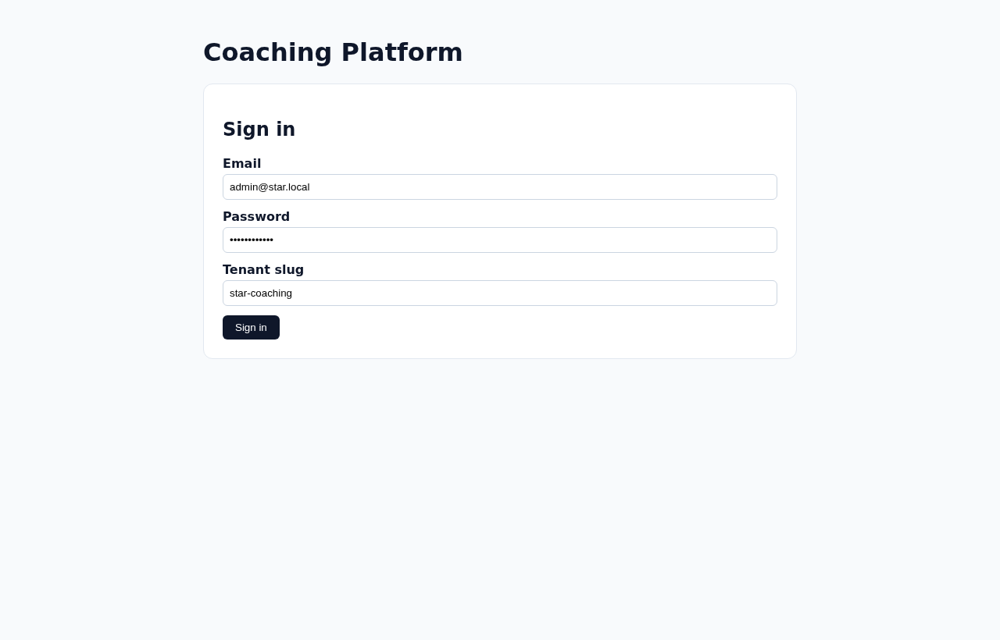
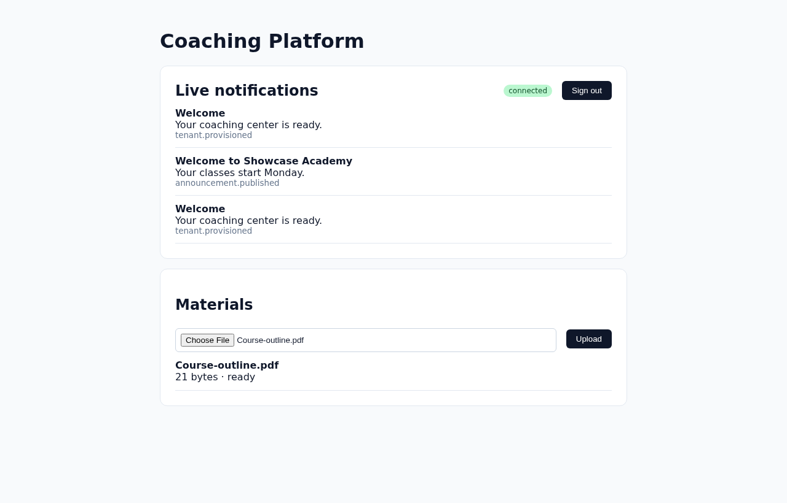
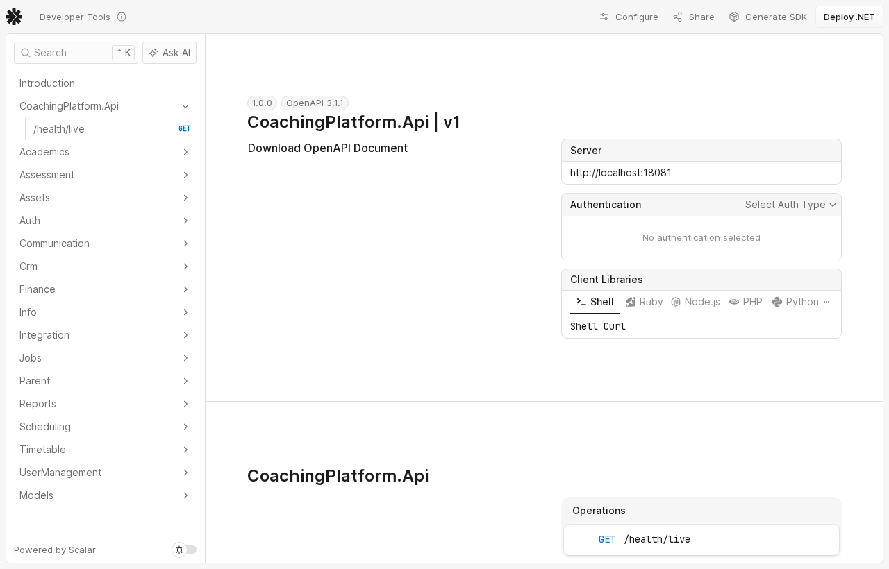

# Coaching Platform

A **multi-tenant, production-shaped coaching-center management system** built with .NET 10, EF Core, PostgreSQL, Redis, MinIO/AWS S3 and React. One deployment serves many isolated coaching centers. The architecture is a conventional layered modular monolith (controllers → services → MediatR use cases → EF Core), ready to be split into microservices.

> Companion service: [Proctored Exam Service](https://github.com/RaiyanKhan19-41453-3/proctored-exam-service) · End-to-end tests: [coaching-e2e](https://github.com/RaiyanKhan19-41453-3/coaching-e2e)

## Screenshots

| Login | Live dashboard | API documentation |
| --- | --- | --- |
|  |  |  |

## Contents

- [Quick start](#quick-start)
- [Architecture](#architecture)
- [Features](#features)
- [Tenancy, security and consistency](#tenancy-security-and-consistency)
- [Background jobs](#background-jobs)
- [Configuration](#configuration)
- [Deployment](#deployment)
- [Testing](#testing)
- [Known boundaries](#known-boundaries)

## Quick start

```bash
cp .env.example .env       # optional — safe development defaults are built in
docker compose up -d --build
```

| Service | URL | Purpose |
| --- | --- | --- |
| Web | http://localhost:13000 | React app (login, notifications, material uploads) |
| API | http://localhost:18081 | ASP.NET Core controllers |
| OpenAPI / Scalar | http://localhost:18081/openapi/v1.json · /scalar/v1 | API contract and interactive docs |
| Health | http://localhost:18081/health/ready · /health/live | Postgres + Redis readiness |
| SignalR | http://localhost:18081/hubs/notifications | Authenticated real-time notifications |
| Hangfire | http://localhost:18081/jobs | Background job dashboard (Development) |
| Postgres | localhost:15432 | Application data |
| Redis | localhost:16379 | SignalR backplane + global rate limits |
| MinIO | localhost:9000 (console 9001) | Object storage for files |

Optional admin tooling: `docker compose --profile tools up -d` (pgAdmin on :5050).

Demo login: `admin@star.local` / `Password123!`, tenant slug `star-coaching`.

## Architecture

```
Api/Controllers  →  Application/Services (I*Service)  →  Application/Features (commands, queries, validators, handlers)
       ↓                        ↓                                   ↓
   DTOs & auth           abstractions (IApplicationDbContext,       Domain entities & policies
                         ICurrentUser, IObjectStorage, ...)
                                   ↓
                       Infrastructure (EF Core, MinIO/S3, interceptors, projections, Hangfire)
```

- **Domain** — entities, enums, `Money` value object and pure policies; no framework dependencies.
- **Application** — API DTOs, service interfaces + implementations, CQRS command/query slices, FluentValidation, MediatR pipeline (logging → tenant guard → validation).
- **Infrastructure** — EF Core 10 model/configurations/migrations, audit interceptor, outbox dispatcher, MinIO + AWS S3 adapters, projection rebuild, PDF generation, email/SMS transport.
- **Api** — thin controllers, JWT auth, tenant resolution, rate limiting, health checks, observability, SignalR, Hangfire, global exception handling.

### Solution map

```
src/CoachingPlatform.Domain        Entities, value objects, domain policies
src/CoachingPlatform.Application   DTOs, services, CQRS use cases, abstractions
src/CoachingPlatform.Infrastructure Persistence, storage adapters, jobs, messaging, documents
src/CoachingPlatform.Api           Controllers, hubs, middleware, Program.cs
tests/CoachingPlatform.Tests       50 unit + integration tests (Testcontainers)
docs/                              ARCHITECTURE.md, DOMAIN-MODEL.md
```

## Features

- **Identity & tenancy** — self-service tenant provisioning, JWT login, hashed rotating refresh tokens, lockout, roles/permissions, parent/guardian links, multi-tenant users
- **Academics** — courses, subjects/topics tree, academic years/terms, batches, teacher assignment, enrolments with capacity control and lifecycle (waitlist promotion, transfer, completion, dropout)
- **Scheduling** — recurring rules → generated sessions, teacher/room conflict detection, room booking/availability, attendance with QR/geofence-ready methods, leave requests
- **Assessment** — question bank, tests with timers/retakes/proctoring flags, auto-grading, manual grading, rubrics, gradebook, report cards (PDF)
- **Finance** — fee structures, installments, discount codes, scholarships, invoices, payments, refunds with reversing double-entry ledger, invoice PDFs
- **Communication** — announcements with role/user/batch fan-out, direct messaging, notification inbox and preferences, real-time push, email (SMTP) and SMS (webhook)
- **CRM** — leads, applications, documents, review workflow and one-click conversion into a student with enrolment, membership, role and guardian link
- **User management** — invite users, assign/remove roles, suspend/activate, searchable paged list
- **Reporting** — dashboards for attendance, fee collection, batch utilization and grades, served from projection tables; audit logs, feature flags, search
- **Files** — presigned uploads/downloads with MinIO or AWS S3, asset registry with scan status
- **Integrations** — accepts exam-service result events via a key-protected endpoint and creates candidate notifications

## Tenancy, security and consistency

- Global EF query filters enforce `!IsDeleted && TenantId == CurrentTenantId` on every tenant row; unique indexes are tenant-scoped and filtered on soft delete.
- Row-version optimistic concurrency on mutable aggregates; conflicts surface as structured `409`.
- Staff-only endpoints require Admin/Teacher; candidate/guardian endpoints use ownership or guardian checks.
- JWT validation with tight clock skew, issuer/audience/signature checks; production refuses default secrets.
- Rate limiting: per-tenant globally via Redis, per-IP on auth endpoints.
- Audit log records every mutation with a JSON change set; secrets are redacted.
- Transactional outbox makes notifications, fan-out and integrations retryable.

## Background jobs

| Job | Schedule | Purpose |
| --- | --- | --- |
| `outbox-dispatch` | every 5 s | Typed handlers → notifications, projections, delivery events; 5 retries then dead-letter |
| `announcement-fanout` | every 5 s | Expands targeted audiences into durable notifications |
| `projection-rebuild` | daily | Authoritative rebuild of reporting projections |
| `refresh-token-cleanup` | daily | Removes expired tokens |

All workers are guarded with `[DisableConcurrentExecution]` for safe multi-replica deployment.

## Configuration

Copy `.env.example` to `.env`. Key settings:

| Variable | Purpose |
| --- | --- |
| `JWT_KEY` | Shared with the exam service; ≥ 32 chars, no dev default in Production |
| `POSTGRES_PASSWORD`, `MINIO_ROOT_PASSWORD` | Storage credentials |
| `STORAGE_PROVIDER` | `minio` (default) or `s3` |
| `AWS_REGION`, `AWS_BUCKET`, `AWS_ACCESS_KEY_ID`, `AWS_SECRET_ACCESS_KEY` | Used when provider is `s3` (IAM role preferred) |
| `SEQ_URL`, `OTEL_ENDPOINT` | Optional observability exporters |
| `RATE_TENANT_LIMIT`, `RATE_AUTH_LIMIT` | Rate limits |
| `EXAM_INTEGRATION_KEY` | Shared secret for exam-service result events |

## Deployment

```bash
docker compose -f docker-compose.yml -f docker-compose.prod.yml up -d --build
```

The production overlay validates required variables, hides internal storage ports and runs EF migrations as a one-shot dependency before the API starts. Full runbook: [DEPLOY.md](DEPLOY.md).

## Testing

```bash
./scripts/run-tests.sh        # 50 tests, real Postgres via Testcontainers
cd ../e2e && ./run-e2e.sh     # browser E2E + four adversarial attack suites (incl. annihilation fuzzing)
```

## Known boundaries

- Reports are eventually consistent (seconds), not transactionally instant.
- Postgres, Redis and MinIO are single services until you add HA (replication, Sentinel, distributed MinIO).
- The frontend focuses on auth, notifications and uploads; most module operations are API-driven.
- Password reset/MFA/SSO, payroll and mobile apps are not implemented.

## Related repositories

- [Proctored Exam Service](https://github.com/RaiyanKhan19-41453-3/proctored-exam-service) — standalone exam microservice
- [coaching-e2e](https://github.com/RaiyanKhan19-41453-3/coaching-e2e) — Playwright E2E and adversarial suites
